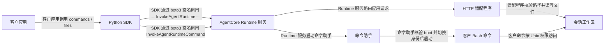

# 客户端 SDK 与 Runtime 适配程序架构

版本：0.1.0。客户应用通过本项目的同步 Python SDK，使用 E2B 风格的 `commands` 和 `files` API 操作 AgentCore Runtime 会话。开发者随 Runtime 部署确定性适配程序；任何组件都不需要调用模型。

## 组件职责

| 组件 | 组件承担的职责 |
|---|---|
| 客户应用 | 客户应用提供 AWS 凭证和允许访问的 RuntimeTarget，校验用户与会话的归属关系，保存 SessionRef，协调跨进程访问并处理业务恢复 |
| Python 客户端 SDK | SDK 校验参数与目标白名单，管理本地会话句柄，调用 AWS API，解析响应与命令事件，并向客户应用返回结果或明确异常 |
| AWS SDK／IAM | boto3／botocore 使用客户配置的 AWS 凭证签署请求；IAM 按调用方身份与策略决定是否允许调用 |
| AgentCore Runtime 服务 | AgentCore Runtime 服务承载会话计算环境，路由应用调用，执行原生命令并受理停止请求 |
| Runtime HTTP 适配程序 | 适配程序提供 `/ping` 和 `/invocations`，创建每次启动的 boot ID，处理初始化、能力协商和受约束的文件操作 |
| Runtime 命令助手 | 命令助手验证协议与 boot ID，按启动标识文件 owner 对齐 Unix 身份，设置工作目录和环境，并启动客户指定的 Bash 命令 |

SessionRef 包含区域、Runtime ARN、Endpoint、会话 ID、boot ID 和部署路径，不包含凭证。客户应用必须把引用当作需要授权检查的资源定位信息，不能把持有引用本身当成授权。

## 调用链路

### 会话创建与重连

1. 客户应用调用 `client.sandboxes.create(template=...)`；SDK 将模板名解析为客户预先配置的 RuntimeTarget，并生成会话 ID。
2. SDK 通过 `InvokeAgentRuntime` 请求初始化；Runtime 服务启动或复用会话计算，HTTP 适配程序返回能力及 boot ID。
3. SDK 校验协议、请求关联标识和能力后返回 Sandbox 句柄。SDK 在创建响应不明时向客户应用暴露 CreateAttempt；客户应用可要求 SDK 恢复同一创建尝试，避免无意创建多个会话。
4. 客户应用通过 `sbx.runtime.export_ref()` 保存引用，通过 `client.sandboxes.connect(ref)` 构造本地句柄。SDK 在首次远程操作时协商能力，并拒绝不符合目标白名单、部署配置或当前 boot ID 的引用。

HTTP 适配程序每次启动生成新的 boot ID。SDK 和适配程序使用该值识别计算环境的更替，不把它用作认证秘密。SDK 不承诺会话重新启动后文件或进程仍然存在。

### 文件操作

SDK 将文件请求编码为 JSON 并调用 `InvokeAgentRuntime`。HTTP 适配程序验证协议、请求与启动标识后，在配置工作区内执行 `read`、`write`、`list`、`make_dir` 或 `remove`。适配程序拒绝越界路径、符号链接、超限文件和非空目录删除，并使用真实文件元数据构造返回值。

适配程序将单文件限制为 1 MiB，将单次目录列表限制为 1000 项。文件 API 的路径规则约束这些 API；客户 Bash 命令仍按操作系统权限运行，工作区路径检查不构成同容器内的恶意代码隔离。

### 命令执行

SDK 将部署路径和命令参数显式传给命令助手，并通过 `InvokeAgentRuntimeCommand` 请求 Runtime 执行。命令助手读取工作区外的 boot 文件，检查启动标识，并在原生命令入口为 root 时切换到 HTTP 应用的 UID／GID，然后启动 Bash。

命令助手先输出带关联标识的协议头，再输出客户命令内容。SDK 校验并剥离协议头，按事件顺序累计 stdout／stderr、调用客户回调，并检查终止事件。SDK 对断流、缺失终止事件、无效协议头和流内错误返回异常；非零退出的异常保留 stdout、stderr 和 exit_code。

SDK 默认将命令输出限制为 8 MiB。客户的同步输出回调应及时返回，SDK 不能强制打断任意 Python 回调。

## 生命周期与失败处理

| 客户动作或故障 | 组件行为 |
|---|---|
| 客户调用 `close()` | SDK 关闭本地连接与对象，不请求停止远端计算 |
| 客户调用 `runtime.stop()` | SDK 向服务发送停止请求，保存并在重试中复用 clientToken；Runtime 服务决定如何停止当前计算 |
| 服务接受 stop | SDK 记录 `STOP_REQUESTED`；SDK 不把受理结果解释为永久删除会话 ID |
| stop 响应不明 | SDK 记录 `STOP_UNKNOWN` 并阻止普通操作；客户应用可使用同一停止令牌重试 |
| 客户等待期限到达 | SDK 结束本地等待并报告远端状态可能未知；SDK 不保证已中止服务端进程 |
| Runtime 执行期限到达 | SDK 将执行超时与客户等待超时区分，避免伪造正常退出结果 |
| 命令或写入结果不明 | SDK 不自动重放操作；客户应用根据异常、部分结果及业务语义决定恢复方式 |
| 同一 client 并发访问同一会话 | SDK 拒绝冲突或重入操作；客户应用仍负责其他 client 和进程之间的协调 |

## 部署与兼容边界

部署脚本可使用 CodeZip 创建独立 Runtime、私有 S3 工件桶和执行角色。CodeZip 的代码目录与可写工作区不同；SDK 的 RuntimeTarget 必须与部署脚本记录的 `workspace`、`boot_file`、`module_path` 一致。自定义镜像的默认工作区是 `/workspace`，boot 文件是 `/app/run/boot.json`，通常不需要额外 module_path。

HTTP 适配程序依赖 AgentCore 的入站鉴权；开发者不能直接向不可信网络暴露这个没有独立身份认证的 HTTP 服务。客户应用负责 IAM 权限与会话授权，Runtime 服务负责计算环境隔离，适配程序负责其公开协议和文件操作边界。

首版支持同步 Python、IAM 调用、前台命令、输出回调与基础文件操作。SDK 不支持原版 E2B 的完整协议或类型身份，也不提供永久 kill、单会话 TTL、PTY、后台进程、端口代理、暂停／恢复、快照或有状态 `run_code`。验收范围见 [测试标准](acceptance.md)，实际结果见 [测试报告](test-report.md)。
